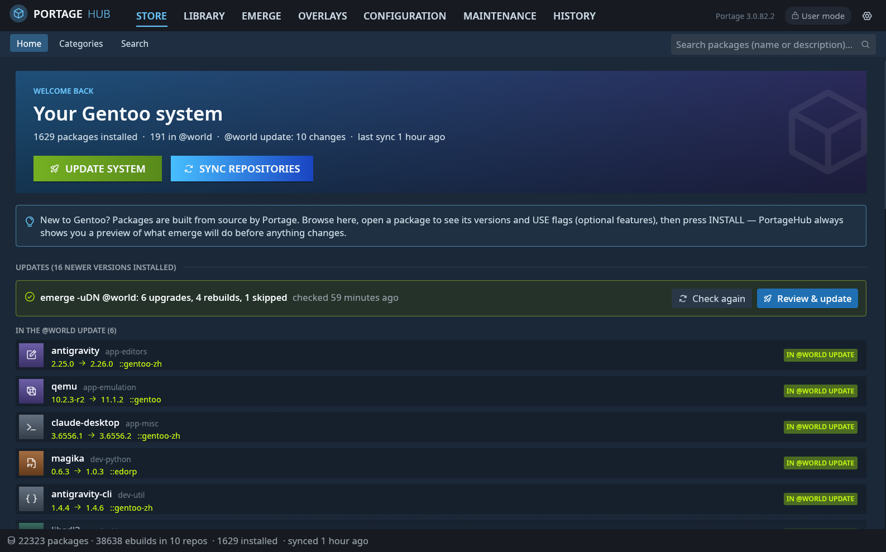
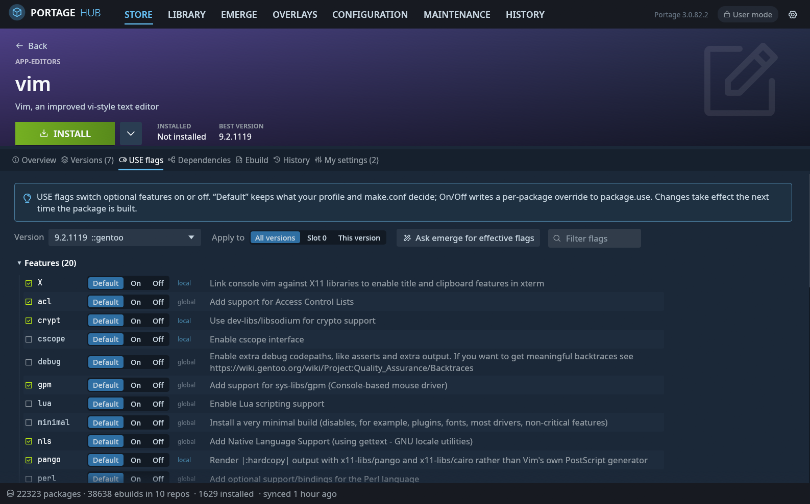
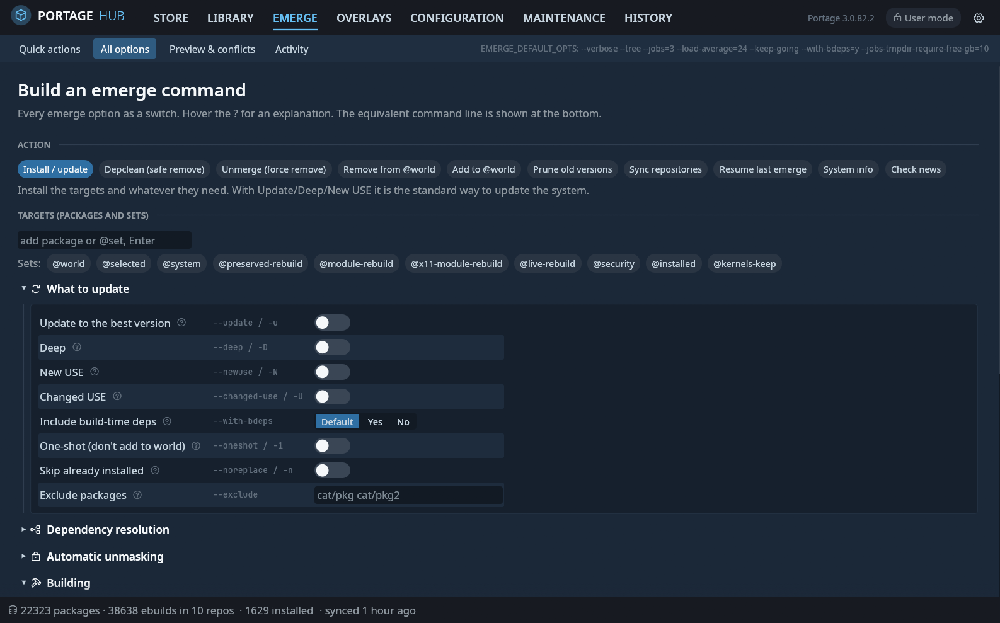
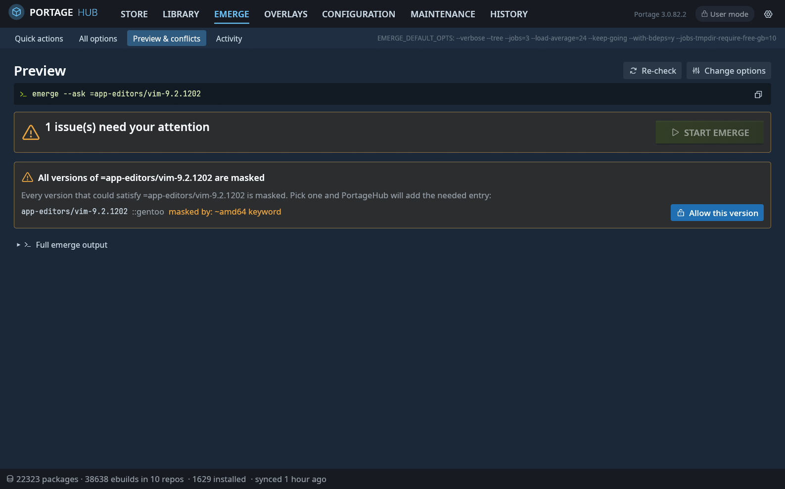
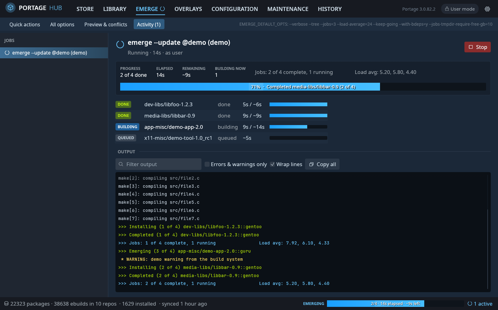
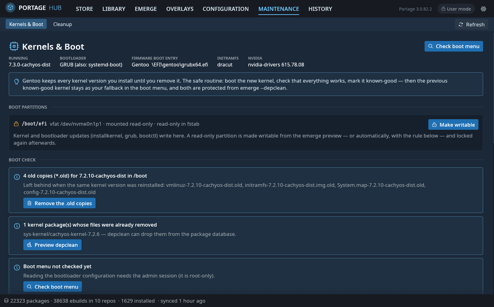

# PortageHub

A Steam-styled graphical front end for Gentoo's Portage, written in Rust (egui/eframe).
Everything you would do with `emerge`, `eselect repository` and the files in
`/etc/portage` is available as buttons, switches and menus — with plain-language
explanations for newcomers and every expert option still within reach.

## Quick start

From the bundled overlay (`dist/gentoo`, needs Rust ≥ 1.95; Portage can only fetch
the release tarball once the GitHub repository is public):

```sh
sudo cp -r dist/gentoo /var/db/repos/portagehub
printf '[portagehub]\nlocation = /var/db/repos/portagehub\n' | sudo tee /etc/portage/repos.conf/portagehub.conf
sudo ebuild /var/db/repos/portagehub/app-portage/portagehub/portagehub-0.4.0.ebuild manifest
sudo emerge --ask app-portage/portagehub
```

Or build it yourself:

```sh
cargo build --release
sudo dist/install.sh      # binaries, polkit policy, menu entry
portagehub
```

Add yourself to the `portage` group (`sudo usermod -aG portage $USER`, then log in
again) so history and live build logs are readable. The first privileged action asks
for your password through polkit. Every change PortageHub makes as root is logged and
can be undone from **History → PortageHub changes**. The [security model](SECURITY.md)
explains how the root helper is protected.

## Screenshots

| | |
|---|---|
|  |  |
| **Store** — your system at a glance; updates checked against `emerge -uDN @world` | **Package page** — USE flags as switches, with descriptions and scope |
|  |  |
| **All options** — every emerge flag as a switch, radio or number field | **Preview & conflicts** — problems turned into one-click fixes |
|  |  |
| **Activity** — per-package stages, elapsed and remaining time, live log | **Kernels & Boot** — known-good kernels, boot partitions, boot check |

## Features

- **Store** — browse all packages from every repository, category tiles, fast search
  (name or description, per-repository filter), possible updates, unread news.
- **Library** — installed packages Steam-library style: filter by @world, dependencies,
  updates or orphans (installed but no longer in any repository).
- **Package page** — big INSTALL / UPDATE / REBUILD button with an options menu
  (specific version, slot, `--oneshot`, fetch only, binary packages, depclean, unmerge,
  @world select/deselect, `pkg_config`), and tabs for:
  - *Versions* grouped by slot with STABLE / TESTING / NO KEYWORD / LIVE / MASKED badges
    (including the reason from the repository's `package.mask`); click a version for
    install, keyword, mask/unmask and license actions.
  - *USE flags* with descriptions (`metadata.xml`, `use.desc`, `use.local.desc`,
    USE_EXPAND), a Default/On/Off switch per flag, scope (all versions / slot / version)
    and “ask emerge for the effective flags”.
  - *Dependencies* as a tree with USE conditionals, installed markers, click-through,
    and reverse dependencies.
  - *Ebuild* source with syntax highlighting, `files/` list; *Files* (CONTENTS);
    *History* (build times from `emerge.log`); *My settings* (every `/etc/portage`
    line affecting the package, with on/off switches).
- **Emerge** — one-click recipes (update @world, apply USE changes, preserved-rebuild,
  depclean, fetch only, resume, empty tree), and a builder that exposes every emerge
  option as a switch / yes-no-default / number field with help text and the equivalent
  command line. Every change runs as a **preview** first (`--pretend`), parsed into:
  - the merge list (NEW / UPDATE / REBUILD / DOWNGRADE / NEW SLOT, binaries, changed USE),
    estimated build time from your own history and download size;
  - **conflict handling**: autounmask suggestions as checkboxes you can apply in one
    click (then the preview re-runs), masked packages with “Allow this version”, slot
    conflicts with retry options (backtracking, full world update, verbose conflicts,
    autounmask backtracking), blockers, REQUIRED_USE, circular dependencies with USE
    fixes, ambiguous names, missing packages (search / find an overlay), news,
    preserved libraries and config-file updates.
- **Activity** — live progress of running emerges (also for parallel `--jobs`): per
  package stage (queued, building with the current phase from the build log,
  installing, done, failed), elapsed vs. expected time, overall progress and ETA,
  filterable coloured log, Stop / Resume / Resume-skip-first. A Steam-style
  “EMERGING” bar stays visible in the footer on every page.
- **Overlays** — repository cards (sync type, priority, ebuild count, last sync, masters,
  file), per-repo sync, `egencache`, inline repos.conf editing, remove/disable, the
  official overlay list (`eselect repository`), and custom git/rsync/hg/svn or local
  overlays.
- **Configuration** — every `package.*` file (`use`, `accept_keywords`, `mask`,
  `unmask`, `license`, `env`, `properties`, `accept_restrict`, legacy `keywords`,
  sets, profile overrides) in file or directory form: lines become rows with an
  on/off switch (comment/uncomment), edit, delete, a guided “add entry” wizard and a raw
  editor. Plus a **guided make.conf**: what this machine is (threads, RAM, GPU, what
  `-march=native` resolves to, cpuid2cpuflags), a **health check** that compares the
  file with the Gentoo documentation (CHOST, -O3/-Ofast, graphite, LDFLAGS and
  RUSTFLAGS overrides, MAKEOPTS against RAM, disabled sandbox features, ACCEPT_LICENSE,
  pinned PYTHON_TARGETS, USE_EXPAND variables that belong in package.use, deprecated
  and root-executed variables …) with a source link and, where safe, a one-click fix;
  a compiler-flags card that edits only `-O`/`-march` and previews the effective
  values with Portage itself; and the MAKEOPTS, branch, license, FEATURES, USE and
  hardware cards. Every make.conf change is checked by Portage's own parser before
  it is written and again before it is committed (a broken make.conf is otherwise
  silently ignored by Portage), and rolled back if Portage cannot read it.
  `/etc/portage/env` files with templates, profile switching, news, `._cfg` config
  updates with diffs, and a **stray-file detector** for files Portage silently ignores
  (e.g. `package.accept_keywordschatgpt-desktop`), which it can merge into the right place.
- **Maintenance → Kernels & Boot** — every installed kernel mapped to its package,
  /boot image, initramfs, /lib/modules and /usr/src tree, with RUNNING / LAST-GOOD /
  PREVIOUS-GOOD / NEWEST tags. A boot check reads the root-only bootloader files
  through the helper (GRUB, systemd-boot, LILO; rEFInd/Limine/EFI stub detected) and
  reports kernels missing from the menu, stale entries, missing initramfs or modules,
  a LILO that was not re-run, and offers the fix (grub-mkconfig, lilo, bootctl update,
  dracut, emerge --config). **Known-good rules**: mark the running kernel known-good
  (optionally only after nvidia-smi works), keep a backup in /boot/kernel-backup, and
  protect the last two known-good kernels from depclean through a set in @world
  (compatible with /var/lib/kernel-fallback and @kernels-keep). Old-kernel cleanup never
  touches the running or known-good kernels and can refuse until the newest kernel is
  marked. **NVIDIA**: checks that every kernel has an nvidia.ko matching the installed
  driver and alerts after kernel or driver updates, with the right rebuild option for
  dist-kernel and non-dist-kernel setups.
- **Boot partition pre-flight** — when a preview contains kernel or bootloader packages,
  PortageHub checks that /boot, /boot/efi and /efi are mounted read-write. A read-only
  EFI partition (e.g. `ro` in fstab) is remounted with one click (`mount -o remount,rw`)
  and locked again when the emerge finishes; an optional rule does both automatically.
- **Maintenance → Cleanup** — unused packages (depclean scan with Keep/Remove per
  package), old kernels and /boot leftovers, distfiles and binary packages (eclean),
  old build logs, failed build directories, world-file entries for uninstalled
  packages, dead or no-longer-needed /etc/portage lines, preserved libraries and read
  news.
- **History** — every merge, failure, removal and emerge command from `emerge.log`,
  compile-time totals and a per-day chart. **PortageHub changes** lists everything
  done as root, from the audit log: file changes can be undone, and a batch whose
  step failed was rolled back as a whole.

Every write to `/etc/portage` is shown as a diff first (can be turned off), written
atomically and can be undone; new entries go to a dedicated `zz-portagehub` file in
each directory.

## Build and run

```sh
cargo build --release
./target/release/portagehub
```

Keep `portagehub` and `portagehub-helper` next to each other (or install them, below).
Your user should be in the `portage` group so the history and live build logs are readable.

### Administrator rights

Browsing and previews run as your user. The first action that needs root starts
`portagehub-helper` through **pkexec**. polkit asks for your password each time the
helper starts, which is once per PortageHub session. The helper talks only to the
PortageHub process that started it, over a private socket. It only runs Portage tools
(`emerge`, `emaint`, `eselect`, `egencache`, …) with checked arguments, and writes only
below `/etc/portage`, plus a few operations of fixed shape:

- `._cfg` config updates below `/etc`;
- known-good kernel records and their /boot backup;
- remounting /boot, /boot/efi or /efi;
- removing files of uninstalled kernels and leftover build directories.

Every change is saved in a journal (`/var/lib/portagehub/journal`) so it can be
undone, and every request goes to `/var/log/portagehub/audit.log`. See
[SECURITY.md](SECURITY.md) for the details and the threat model.

After updating PortageHub, run `sudo dist/install.sh` again (or re-emerge). The app
warns when the installed helper is older than the GUI. If you close PortageHub during
an emerge, the helper keeps it running until it finishes.

To install system-wide by hand (adds the polkit policy so the prompt shows a proper
message):

```sh
cargo build --release
sudo dist/install.sh
```

### Environment variables

| Variable | Purpose |
| --- | --- |
| `PORTAGEHUB_ELEVATE` | Launcher for the helper: `pkexec` (default), another command such as `doas`, or `none` to run it unprivileged (testing). |
| `PORTAGEHUB_HELPER` | Absolute path of the helper binary to use instead of the one next to the GUI or in `/usr/libexec`. |
| `PORTAGEHUB_DEMO=1` | Replays a synthetic parallel emerge to try the progress view without building anything. |
| `PORTAGEHUB_SCRIPT` | UI automation for screenshots, e.g. `tab=library;open=app-editors/vim;dtab=use;wait=2;shot=/tmp/vim.png;exit`. |
| `PORTAGEHUB_ROOT` | Testing: a scratch tree the helper (and the change log) use instead of `/`. Ignored when running as root. |
| `PORTAGEHUB_STRICT_PEER=1` | Testing: apply the root-only peer check to an unprivileged helper too. |

`portagehub --makeconf-check` runs the make.conf health check and checks every
suggested fix with Portage's parser, without writing anything.
`portagehub --self-test` prints what was read from your system (repositories, tree,
installed packages, history, masks, configuration, update estimate) without opening a window.

## Tests and checks

```sh
cargo fmt --check
cargo clippy --all-targets -- -D warnings
cargo test
```

Unit tests cover PMS version ordering, atoms, dependency strings, repos.conf,
make.conf, `package.*` parsing and editing, the pretend-output parser, progress
tracking, emerge.log parsing, the policy checks, the symlink-safe file layer, the
journal, and the job/batch state machines. The integration tests drive the real
helper over a socketpair in a scratch root. They cover symlink escapes, byte-for-byte
rollback, undo, the kernel and cleanup operations, the peer check, and the blocked
`/proc/<pid>/fd` reopen. Tests that run `emerge` skip themselves where Portage is
missing (or with `SKIP_EMERGE_TESTS=1`). CI runs everything on Ubuntu and in a Gentoo
stage3 with the Portage tree.

## Packaging

`dist/gentoo` is a small overlay with a live (`9999`) and a release ebuild
(`cargo.eclass`; the helper goes to `/usr/libexec`). For a new release, update the
version and run `python3 dist/gentoo/update-ebuild.py <ebuild>` to regenerate `CRATES`
and the crate licenses from `Cargo.lock`.

## License

GPL-2.0-or-later — see [LICENSE](LICENSE).
